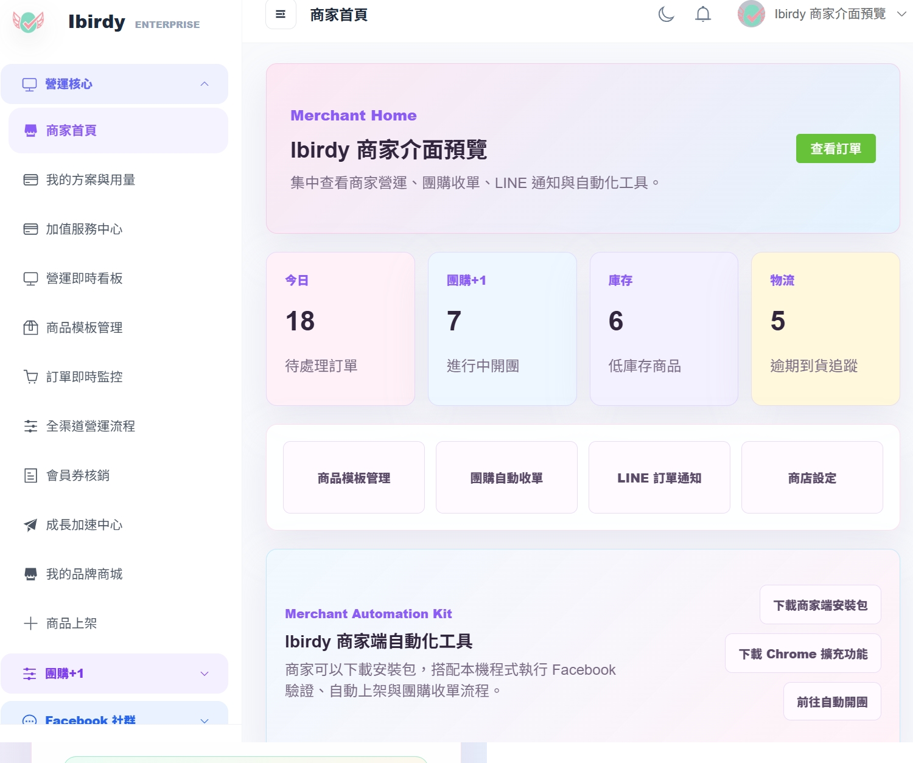
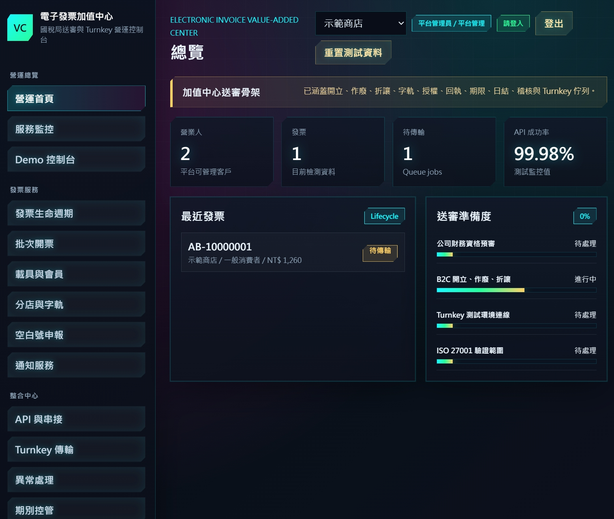

# Arille Operations Automation Portfolio

這是一組以真實營運需求為核心整理出的作品集。內容涵蓋 SaaS 後端、營運控制台、電子發票加值中心原型、瀏覽器自動化、Excel 工作流、自動上架工具，以及 legacy PHP 系統轉 Python 的移植練習。

這個 repository 採用 portfolio case study 形式：重點放在問題拆解、架構設計、可交付成果、風險控管與技術學習軌跡。為了保護工作資料，公開版不包含正式帳號、客戶資料、真實資料庫、Chrome profile、cookies、token、內部網址或大型可執行檔。

## Featured Projects

| Project | Focus | Tech |
| --- | --- | --- |
| [IBirdy SaaS Commerce API](projects/ibirdy-saas-commerce-api.md) | 多租戶電商營運後端、訂單、商品、庫存、社群訊息整合 | ASP.NET Core, SQL Server, EF Core, Dapper, JWT, Hangfire |
| [IBirdy Merchant Operations Console](projects/ibirdy-merchant-operations-console.md) | 商家後台、營運儀表板、社群訂單、最新 IBirdy 自動上架工具 | Vue 3, Vite, Pinia, Element Plus, Playwright, Chrome Extension |
| [Electronic Invoice Value Center](projects/invoice-value-center.md) | 電子發票加值中心原型、非同步佇列、webhook、營運文件 | Node.js, REST API, Worker, Docker, HMAC |
| [會員與訂單資料遷移工具](projects/member-order-migration.md) | 歷史訂單分段匯出、會員關聯、Excel 匯入前核對 | C# / .NET 8, WPF, Playwright, ClosedXML |
| [JJ Auto Listing Publisher](projects/jj-auto-listing-publisher.md) | Excel 驅動 Facebook 社團排程發文與桌面工具包 | Playwright, Node.js, xlsx, .NET WinForms |
| [Legacy PHP To Python Port](projects/legacy-php-to-python-port.md) | 舊 PHP 團購系統盤點、路由映射、Python Web 移植基礎 | Python, Flask/FastAPI path, Jinja2 path, Docker, Playwright |

## 專案畫面

| IBirdy 商家首頁 | 電子發票加值中心 |
| --- | --- |
| [](projects/ibirdy-merchant-operations-console.md) | [](projects/invoice-value-center.md) |

## What This Portfolio Shows

- 可以從營運痛點出發，把人工流程拆成可執行工具。
- 能設計 SaaS 後端與商家前台的資料流、權限、稽核與營運模組。
- 熟悉 Excel、社群平台、瀏覽器自動化、桌面包裝與錯誤診斷。
- 能處理 legacy system migration，不只是重寫小型 demo。
- 具備把 prototype 整理成交付包、文件、檢查清單與可維護架構的能力。

## Portfolio Positioning

這些專案適合用以下定位公開：

- Internal prototype / Proof of Concept
- Operations automation case study
- Legacy modernization case study
- SaaS admin console prototype
- Browser automation and desktop workflow tooling

不建議把它們描述成已正式營運的完整商用產品。比較好的說法是：我把真實需求拆成可執行的系統原型，並補上部署、測試、操作與風險控管文件。

## Repository Contents

```text
.
├── README.md
├── projects/
│   ├── ibirdy-saas-commerce-api.md
│   ├── ibirdy-merchant-operations-console.md
│   ├── invoice-value-center.md
│   ├── jj-auto-listing-publisher.md
│   ├── member-order-migration.md
│   └── legacy-php-to-python-port.md
├── assets/
├── resume-project-summaries.md
└── publishing-checklist.md
```

## Before Publishing

請先跑完 [publishing-checklist.md](publishing-checklist.md)。尤其要確認沒有上傳 `.env`、`appsettings.json` 真實連線字串、Excel 正式資料、Facebook 群組網址、使用者截圖、cookies、Chrome profile、資料庫 dump 或大型 `.exe`。

